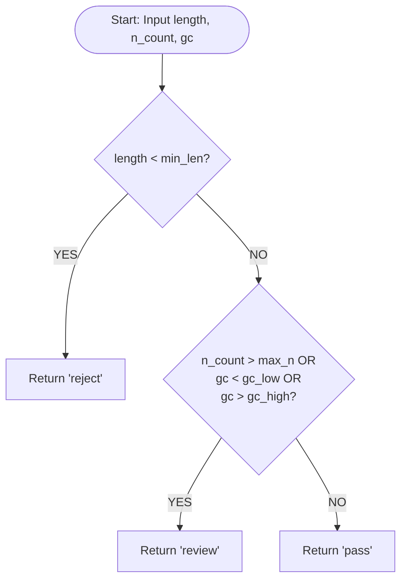

# Lab 3: Quality Control Pipeline Design

## Problem
- **Input**:
  - Sequencing records with `length` (integer or numeric string), `n_count` (integer or numeric string), and `gc_percent` (float or numeric string).
  - List of quality scores `quals` (list of integers) and integer threshold `threshold`.
- **Output**:
  - `classify_read`: Decision string ('reject', 'review', or 'pass').
  - `qc_summary`: Dictionary mapping decisions to counts (`{'pass': n, 'review': n, 'reject': n}`).
  - `trim_low_quality`: Integer index indicating where the low-quality tail begins (number of bases to retain).
- **Constraints**:
  - Rule order matters: length threshold is checked first (`reject`).
  - Boundary inclusion: 500 bases passes; 10 N bases passes; GC of 30.0% and 70.0% are inclusive (`pass`).
  - Threshold parameters must be keyword-only.
  - While loop in trimming must guard against negative indices and empty lists without causing `IndexError`.

## Pseudocode
```text
CONSTANTS:
    MIN_LEN = 500
    MAX_N = 10
    GC_LOW = 30.0
    GC_HIGH = 70.0

FUNCTION classify_read(length, n_count, gc, *, min_len=MIN_LEN, max_n=MAX_N, gc_range=(GC_LOW, GC_HIGH)):
    // Rule 1: Reject reads strictly shorter than min_len
    IF length < min_len THEN
        RETURN "reject"
    END IF

    // Rule 2: Review reads with excessive N bases or GC outside inclusive range
    low_gc, high_gc = gc_range
    IF n_count > max_n OR gc < low_gc OR gc > high_gc THEN
        RETURN "review"
    END IF

    // Rule 3: Pass reads meeting all quality criteria
    RETURN "pass"
END FUNCTION

FUNCTION trim_low_quality(quals, threshold=20):
    SET end = LENGTH(quals)
    WHILE end > 0 AND quals[end - 1] < threshold DO
        SET end = end - 1
    END WHILE
    RETURN end
END FUNCTION
```
## Flowchart

### 1. Classification Flowchart (`classify_read`)



### 2. Trimming Flowchart (`trim_low_quality`)

```mermaid
flowchart TD
    StartTrim([Start: Input quals, threshold]) --> InitEnd[Set end = length of quals]
    InitEnd --> CheckLoop{end > 0 AND<br/>quals[end - 1] < threshold?}
    CheckLoop -- YES --> Decrement[Set end = end - 1]
    Decrement --> CheckLoop
    CheckLoop -- NO --> ReturnEnd([Return end])
```

## Trace
Hand-trace table for records R03, R04, R05, and R07 from data/qc_records.csv:

| sample | length | n_count | gc | length < 500? | N > 10 or GC outside 30-70? | decision |
| :--- | :--- | :--- | :--- | :--- | :--- | :--- |
| **R03** | 420 | 0 | 68.5 | **True** (420 < 500) | *Not evaluated* (short-circuited by Rule 1) | **reject** |
| **R04** | 500 | 10 | 45.0 | **False** (500 is not < 500) | **False** (10 is not > 10; 45.0 in [30.0, 70.0]) | **pass** |
| **R05** | 640 | 3 | 72.4 | **False** (640 is not < 500) | **True** (72.4 > 70.0) | **review** |
| **R07** | 499 | 0 | 50.0 | **True** (499 < 500) | *Not evaluated* (short-circuited by Rule 1) | **reject** |
